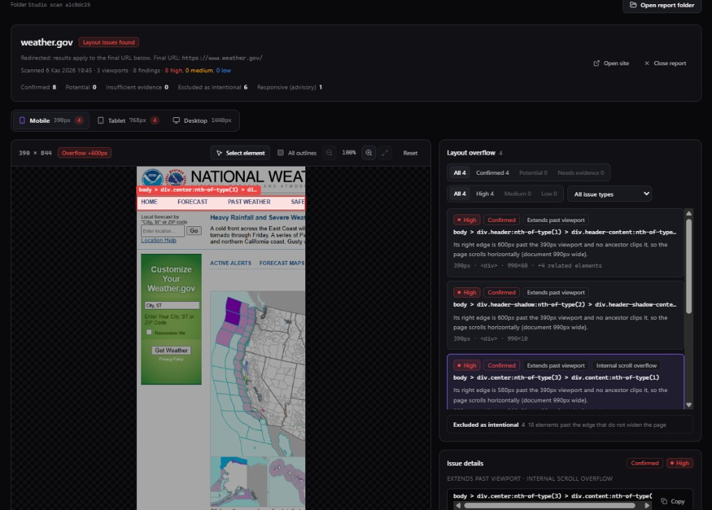
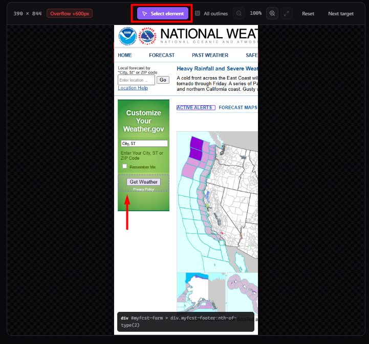

# LayoutLens

**Catch broken layouts before your users do.**

LayoutLens is a **local-first** developer tool that uses **Chromium (Playwright)** to scan web pages at standard responsive widths, detect **horizontal overflow** with **evidence-based classification**, optional **advanced responsive advisories**, **per-viewport screenshots**, and optional **visual regression** against saved baselines. Reports work offline; there is **no cloud account, API keys, or telemetry**.

**Documentation:** [English](README.md) · [Türkçe](docs/README.tr.md)

---



*Public website scan used as a UI example; third-party sites and results may change.*

---

## Key features

- **Chromium-based inspection** — Real headless browser measurement, not static HTML guessing.
- **Evidence-based overflow detection** — Classifications such as confirmed vs potential, excluded groups (e.g. carousels) with reasons, and **visible-only overlays** when content is partly clipped.
- **Responsive layout advisories** — Separate **advanced** findings (overlap, text clipping, offscreen controls, touch targets) in JSON and Studio; **horizontal overflow exit semantics** remain primary.
- **Interactive DOM Inspector (Studio)** — After a scan, pick elements on the screenshot and inspect selector paths and related context (when inspector snapshots are present).
- **Offline HTML reports** — Self-contained bundles with screenshots, filters, and **inspector** UI where data is included (see screenshot tools in generated `index.html`).
- **Visual regression** — Optional **pixelmatch** comparison vs a baseline directory (`layoutlens baseline create|update`).
- **HTTP and navigation awareness** — Summary reflects response status, redirects, and trust hints; does not treat error pages as a “clean” layout proof.
- **Navigation reliability (Phase 9.x)** — Separate timeouts for navigation, load readiness, and screenshots; bounded recovery when the document is usable but load never settles; **per-viewport** success/failure/skipped status.
- **Privacy** — Runs on your machine; scan output stays under your chosen data directory.

---



*Inspector: select elements on the captured viewport and inspect DOM/selector context.*

---

## Quick Start

**Requirements:** Node.js **20+**, [pnpm](https://pnpm.io/) **9+** (see root `package.json`).

```bash
git clone https://github.com/mustafabasdemir/layoutlens.git
cd layoutlens
pnpm install
pnpm browser:install
pnpm build
```

Installs Playwright’s Chromium binary (`pnpm browser:install`).

Scan a URL (CLI wraps `packages/cli/dist/index.js`):

```bash
pnpm cli scan https://example.com
```

Scan the bundled **broken layout** demo with an absolute `file://` URL (adjust the path for your OS):

From the repository root, use an absolute `file://` URL (paths must point at your clone):

```bash
# macOS / Linux (bash)
pnpm cli scan "file://${PWD}/examples/broken-layout/index.html"
```

```powershell
# Windows PowerShell — replace D:\dev\layoutlens if your clone lives elsewhere
pnpm cli scan "file:///D:/dev/layoutlens/examples/broken-layout/index.html"
```

---

## CLI usage

Entrypoint: `layoutlens` (see `packages/cli/src/index.ts`, version **0.4.0**).

**Commands**

| Command | Purpose |
|---------|---------|
| `scan <url>` | Scan a single page (`http`, `https`, or `file:`) |
| `baseline create <url>` | Create a visual baseline (requires `--baseline-dir`) |
| `baseline update <url>` | Update baseline when URL matches manifest |

**`scan` options (representative)**

| Option | Description |
|--------|-------------|
| `--no-headless` | Show the browser window |
| `-H, --height <px>` | Viewport height (default **844**) |
| `-f, --format <format>` | Output: `text` (default), `json`, or `html` |
| `-o, --output <path>` | File for `text`/`json`, **directory** for `html` |
| `-b, --baseline-dir <path>` | Compare screenshots to a baseline |
| `-c, --visual-config <path>` | JSON for thresholds, masks, stability |
| `--nav-timeout-ms` | `page.goto` timeout (`waitUntil: domcontentloaded`) |
| `--readiness-timeout-ms` | Wait for `load` after DOMContentLoaded |
| `--screenshot-timeout-ms` | Per-viewport screenshot timeout |
| `--post-load-settle-ms` | Bounded delay after readiness before measurement |

HTML report requires `-o`:

```bash
# macOS / Linux — ${PWD} is the repo root in your shell
pnpm cli scan "file://${PWD}/examples/broken-layout/index.html" --format html --output ./layoutlens-report
```

```powershell
# Windows PowerShell
pnpm cli scan "file:///D:/dev/layoutlens/examples/broken-layout/index.html" --format html --output ./layoutlens-report
```

Open `layoutlens-report/index.html` in a browser — no CDN required for the bundle.

---

## LayoutLens Studio

Local React + Vite UI (`apps/studio`), wired to a **loopback-only** scan API (`@layoutlens/server`).

**Development (from repo root):**

```bash
pnpm studio
```

Use the URL Vite prints (often `http://127.0.0.1:5173/`).

**Production-style: build Studio and serve static assets + API**

```bash
pnpm studio:serve
```

**Environment / storage**

| Variable / command | Role |
|--------------------|------|
| `LAYOUTLENS_DATA_DIR` | Override where scan artifacts are stored (else **`.layoutlens/`** under the process working directory; typically gitignored) |
| `pnpm server` | Runs **`layoutlens-server`** after `pnpm build`. Use `pnpm server -- --help` for flags (`--host` defaults to **127.0.0.1**, `--port`, `--data-dir`, `--static-dir`, etc.). |

The API binds to **127.0.0.1** by default, validates origins, and applies URL policy (schemes, SSRF-related checks, optional private-network rules). See `packages/server/src/cli.ts` and `packages/server/src/http-api.ts`.

---

## Interactive DOM Inspector

- **Studio:** After opening a report, enable inspector-style interaction on the screenshot (element selection, related navigation) where snapshot data exists.
- **Server-driven scans** run with inspector capture **enabled** for Studio (`packages/server/src/scan-service.ts`).
- **Offline HTML** bundles can include the same inspector experience when reports embed the snapshot (see `packages/report` Playwright tests for `file://` behavior).

Inspector data is **bounded** (limits on depth, elements, selector length); huge pages may truncate — the report states when limits apply.

---

## Visual regression

1. Create a baseline directory with explicit screenshots + manifest:

   ```bash
   pnpm cli baseline create "file://${PWD}/examples/broken-layout/index.html" --baseline-dir ./baselines/example
   ```

2. Compare on scan:

   ```bash
   pnpm cli scan "file://${PWD}/examples/broken-layout/index.html" \
     --baseline-dir ./baselines/example \
     --format html --output ./layoutlens-report
   ```

   On Windows PowerShell, use the same absolute `file:///D:/.../examples/broken-layout/index.html` form as in Quick Start.

Optional `examples/visual.config.json` documents masks and stability tuning.

---

## Navigation reliability

Scans use **`domcontentloaded`** for initial navigation, then a **readiness** phase (including bounded handling when `load` is slow or background network activity continues), separate **screenshot** timeouts, and **per-viewport** inspection status in JSON/Studio. This avoids relying on `networkidle` for long-lived sites.

---

## Reports and CLI exit codes

- **JSON** reports include `schemaVersion` (e.g. **1.3** for Phase 9.2.1 fields), `summary`, `viewports[]`, optional `navigation`, `navigationDiagnostics`, and inspector snapshots when captured.
- **`exitCodeForResult`** (`packages/cli/src/format.ts`):
  - **0** — No horizontal overflow issues, no visual regression failures, navigation does not block trust, and the scan **fully** completed all viewports (no partial/skipped/failed inspection counts).
  - **1** — Layout and/or visual differences, **or** HTTP/navigation conditions treated as issues, **or** **partial / failed** viewport inspection.
  - **2** — CLI usage error or thrown scan error (e.g. invalid args, hard failure before a usable result).

---

## Architecture

Monorepo (pnpm workspaces):

| Package / app | Role |
|---------------|------|
| `packages/shared` | Types, report schema, classification, inspector and navigation helpers |
| `packages/core` | Playwright scanner, overflow and responsive analysis, screenshots |
| `packages/visual` | Baselines, pixelmatch compare, masks |
| `packages/report` | Offline HTML report generator |
| `packages/cli` | Commander CLI |
| `packages/server` | Local scan API + static Studio serving |
| `apps/studio` | LayoutLens Studio UI |
| `examples/` | Demos and HTML fixtures for tests (`broken-layout`, `layout-cases`, `responsive-cases`, etc.) |

---

## Development and testing

```bash
pnpm lint      # Typecheck all packages
pnpm test      # Unit + integration tests (Chromium required for Playwright suites)
pnpm build     # Build all packages
pnpm browser:install
```

---

## Privacy and local-first principles

- **No** mandatory cloud service or signup.
- **No** API keys shipped for scanning.
- **No** telemetry in this repository’s tooling.
- Scan output and history live in your configured/local directories.

---

## Roadmap

**Planned (Phase 10 — not implemented in this README’s feature set):**

- Multi-page website scanning (same-origin, bounded crawl)
- Site-wide Studio dashboard
- Deeper real-time progress for multi-step runs
- Cancellation / retry orchestration for multi-page workflows
- Custom viewport configuration in product UI

No release dates are committed here.

---

## Contributing

Issues and pull requests are welcome. Please run `pnpm lint` and `pnpm test` before submitting substantial changes.

