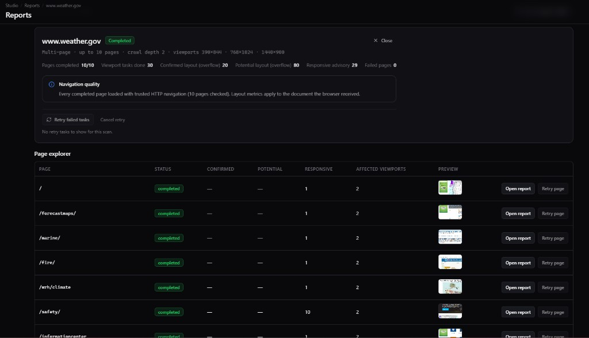

# LayoutLens

**Kullanıcılarından önce kırık düzeni yakala.**

LayoutLens, **Chromium (Playwright)** ile sayfaları ve **LayoutLens Studio** üzerinden **aynı kökende (same-origin) birden fazla sayfayı** responsive genişliklerde tarayan, **yatay taşmayı** kanıta dayalı sınıflandırmayla raporlayan, isteğe bağlı **ileri responsive uyarıları** ve **görsel regresyon** sunan **yerel öncelikli** bir geliştirici aracıdır. **Bulut hesabı, API anahtarı veya telemetri yoktur.**

**Dokümantasyon:** [Türkçe](README.tr.md) · [English](../README.md)

---



*Gerçek Studio çalışması ([weather.gov](https://www.weather.gov)): **10 sayfa**, **30 viewport incelemesi**, site özeti ve Sayfa Gezgini. Üçüncü taraf siteler ve sonuçlar değişebilir.*

---

## Öne çıkan özellikler

### Çok sayfalı web sitesi taraması

Tek bir URL’den başlayarak **aynı origin** içinde sayfa keşfi yapılır. Tarama **sınırlıdır** (Studio’da örneğin varsayılan **en fazla 10 sayfa** ve ayarlanabilir **tarama derinliği**); sınırsız bir örümcek gibi davranmaz. Her sayfa için viewport ölçümü, ekran görüntüsü ve sayfa raporu üretilir.

### Site geneli paneli (dashboard)

Site taraması bittiğinde tek panelde **tamamlanan / başarısız sayfalar**, **viewport görev ilerlemesi**, **onaylanmış ve potansiyel layout bulguları**, **responsive uyarıları** ve **gezinme kalitesi** görüntülenir.

### Sayfa gezgini (Page Explorer)

Taranan sayfalar tabloda listelenir: durum, bulgu sayıları, etkilenen viewport’lar, önizleme, **Raporu aç** ve uygun olduğunda **Sayfayı yeniden dene**.

### Yatay taşma (responsive overflow) tespiti

Gerçek Chromium oturumunda ölçüm; statik HTML tahmini değildir.


*Tek sayfa örneği: kamu sitesinde taşma ve sınıflandırma.*

### Kanıta dayalı sınıflandırma

**Confirmed**, **potential** ve yetersiz kanıt ayrımı; carousel gibi **hariç tutulan** desenler gerekçeli açıklanır; kısmen kırpılan öğelerde **yalnızca görünür geometri** vurgulanır.

### Gelişmiş responsive uyarıları

Yatay taşmanın yanında **örtüşme**, **metin kırpılması**, **ekran dışı kontroller** ve **dokunma hedefi** bulguları JSON ve Studio’da ayrı gösterilir.

### Etkileşimli DOM Inspector

Tarama sonrası ekran görüntüsünden öğe seçimi; seçici yolu, geometri ve kayıtlı CSS bağlamı (snapshot varsa).


### Özel viewport’lar

Studio’da genişlik ve yükseklik (mobil / tablet / masaüstü veya özel değerler). Rapor şeması **1.4** gerekirse özel boyutları kaydeder.

### Canlı tarama ilerlemesi

Site taramalarında keşif, sayfa ve **viewport görevleri** için gerçek ilerleme; sahte dolgu çubuğu yok.

### İptal ve yeniden deneme

Devam eden tarama veya site **retry** işlemi Studio’dan iptal edilebilir. Uygun **sayfa** veya **viewport** görevleri yeniden denenebilir; **HTTP 403** gibi kalıcı hatalar otomatik retry edilmez; görev başına **sınırlı** deneme sayısı vardır.

### Çevrimdışı HTML raporları

Tek sayfa için `index.html`, ekran görüntüleri ve `report.json`; çok sayfalı koşularda `layoutlens-site` JSON ve Studio arayüzü.

### Görsel regresyon

İsteğe bağlı baseline karşılaştırması (`baseline create|update`), diff ve Studio/HTML görünümleri.

### Güvenilir gezinme

HTTP durumu, yönlendirme ve güven ipuçları; navigation / readiness / screenshot için ayrı zaman aşımları; viewport bazlı başarı / başarısızlık / atlandı durumu.

### Yerel öncelik ve gizlilik

Veriler makinenizde kalır (varsayılan **`.layoutlens/`**, genelde gitignore). Zorunlu bulut, kayıt, gömülü API anahtarı veya telemetri yok.

---

## Hızlı başlangıç

**Gereksinimler:** Node.js **20+**, **pnpm 9+** (kök `package.json`).

```bash
git clone https://github.com/mustafabasdemir/layoutlens.git
cd layoutlens
pnpm install
pnpm browser:install
pnpm build
pnpm cli scan https://example.com
```

Yerel örnek (`examples/broken-layout`) için depo kökünden mutlak `file://` yolu kullan:

```bash
# macOS / Linux (bash)
pnpm cli scan "file://${PWD}/examples/broken-layout/index.html"
```

```powershell
# Windows PowerShell — yolu kendi klonuna göre düzenle
pnpm cli scan "file:///D:/dev/layoutlens/examples/broken-layout/index.html"
```

---

## CLI

| Komut | Açıklama |
|--------|-----------|
| `pnpm cli scan <url>` | **Tek sayfa** (`http`, `https`, `file:`) |
| `pnpm cli baseline create …` / `baseline update …` | Görsel baseline |

**Çok sayfalı site taraması** bugün **Studio** ve yerel scan API (`mode: multi_page`) ile yapılır; CLI `scan` alt komutu tek sayfa içindir.

Önemli seçenekler: `-f text|json|html`, `-o` (HTML için **klasör**), `-b baseline`, `-c visual.config.json`, `--nav-timeout-ms`, `--readiness-timeout-ms`, `--screenshot-timeout-ms`, `--post-load-settle-ms`, `--no-headless`, `-H` yükseklik.

Tam liste için `packages/cli/src/index.ts` dosyasına bakın.

---

## LayoutLens Studio

```bash
pnpm studio          # geliştirme
pnpm studio:serve    # derlenmiş arayüz + API
```

- **Tek sayfa** — URL gir, bulgular, ekran görüntüsü, Inspector ve görsel regresyon.
- **Çok sayfa** — Çok sayfalı mod, **sayfa üst sınırı** (ör. 10) ve **derinlik**; isteğe bağlı viewport; bitince **site paneli** ve **Sayfa Gezgini**.
- **İptal / retry** — Uzun koşuları durdur; uygun başarısız görevleri yeniden dene.

**`LAYOUTLENS_DATA_DIR`:** Tarama çıktıları için veri dizinini değiştirir (yoksa genelde `.layoutlens/`).  
API varsayılan olarak **127.0.0.1** üzerinde dinler; köken ve URL doğrulaması vardır.

---

## Dokümantasyon ve mimari

- Kök [README.md](../README.md) — İngilizce tam sürüm (çıkış kodları, mimari tablo).  
- [PHASE8-ARCHITECTURE.md](./PHASE8-ARCHITECTURE.md) — Mimari notlar (eski olabilir; güncel özet için İngilizce README mimari bölümüne bakın).

---

## Geliştirme

```bash
pnpm lint
pnpm test
pnpm build
```

---

## Katkı ve lisans

Katkılar memnuniyetle karşılanır. Ayrıntılar için kök [README.md](../README.md#contributing) ve [LICENSE](../LICENSE) (MIT).
