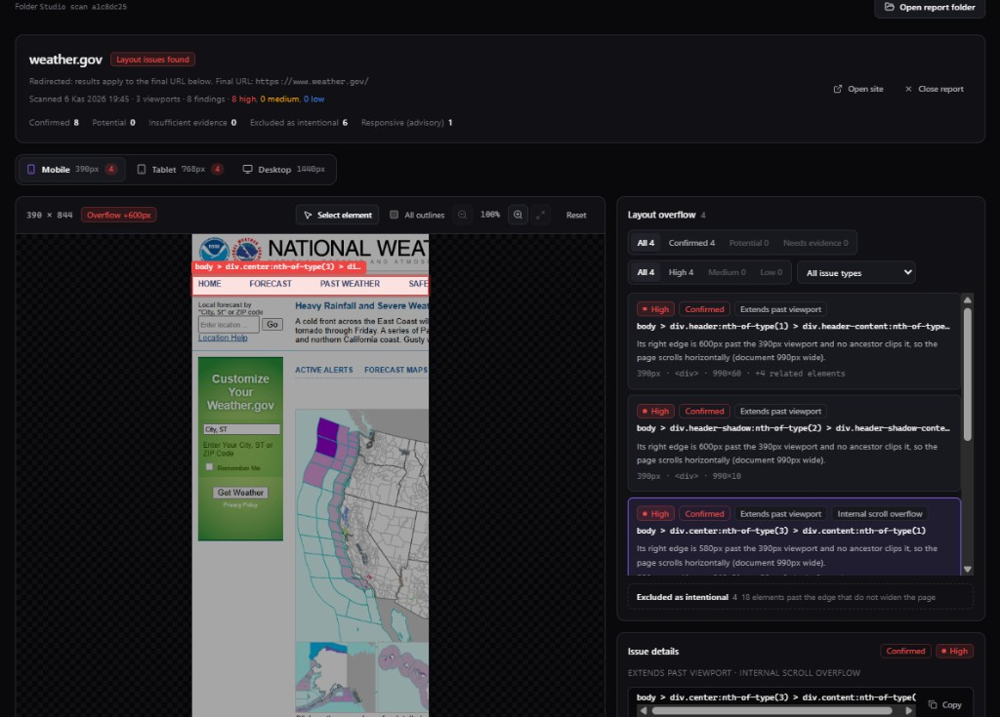
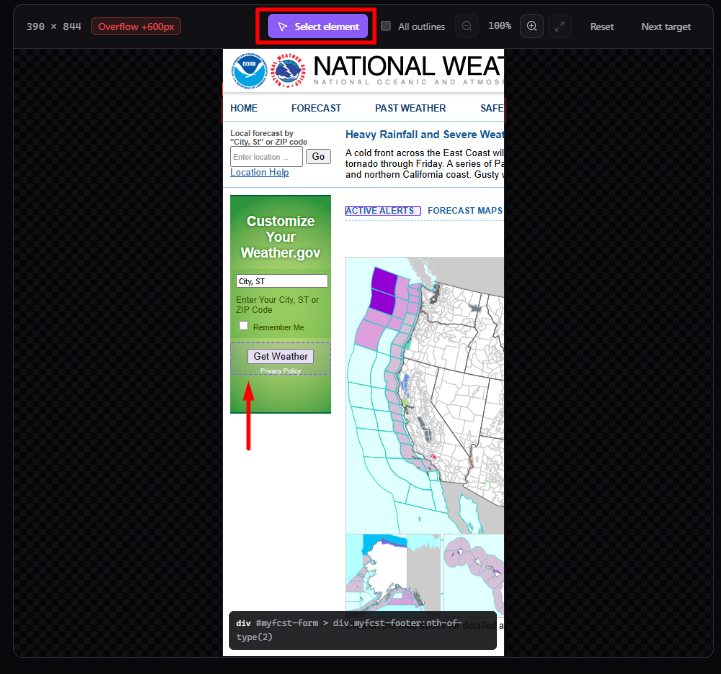

# LayoutLens

**Kullanıcılarından önce kırık düzeni yakala.**

LayoutLens, **Chromium (Playwright)** ile sayfaları standart responsive genişliklerde tarayan, **yatay taşmayı** kanıta dayalı sınıflandırmayla raporlayan, isteğe bağlı **ileri responsive uyarıları** ve **görsel regresyon** sunan **yerel öncelikli** bir geliştirici aracıdır. **Bulut hesabı, API anahtarı veya telemetri yoktur.**

**Dokümantasyon:** [Türkçe](README.tr.md) · [English](../README.md)

---



*Örnek arayüz; üçüncü taraf siteler zamanla değişebilir.*

---

## Öne çıkanlar

- Chromium ile **gerçek tarayıcı** ölçümü  
- **Kanıta dayalı** taşma sınıflandırması (confirmed / potential, hariç tutulan gruplar, kısmen görünür öğeler için overlay)  
- **Gelişmiş responsive uyarıları** (örtüşme, metin kırpılması, ekran dışı kontroller, dokunma hedefi) — JSON ve Studio’da ayrı bulgular  
- **Etkileşimli DOM Inspector (Studio)** — Tarama sonrası ekran görüntüsünden öğe seçimi ve seçici yolu  
- **Çevrimdışı HTML raporları** — Ekran görüntüleri ve filtreler; Inspector verisi gömüldüğünde aynı deneyim  
- **Görsel regresyon** — İsteğe bağlı baseline ile karşılaştırma  
- **HTTP ve gezinme farkındalığı** — Durum kodu, yönlendirme ve güven ipuçları  
- **Gezinme güvenilirliği** — Ayrı zaman aşımları; `networkidle` bağımlılığı yok; **viewport bazlı** tamamlanma durumu  
- **Gizlilik** — Veriler makinenizde kalır  

---



---

## Hızlı başlangıç

**Gereksinimler:** Node.js **20+**, **pnpm 9+** (kök `package.json`).

```bash
git clone https://github.com/mustafabasdemir/layoutlens.git
cd layoutlens
pnpm install
pnpm browser:install
pnpm build
pnpm cli scan https://example.com
```

Yerel örnek (`examples/broken-layout`) için depo kökünden mutlak `file://` yolu kullan:

```bash
# macOS / Linux (bash)
pnpm cli scan "file://${PWD}/examples/broken-layout/index.html"
```

```powershell
# Windows PowerShell — yolu kendi klonuna göre düzenle
pnpm cli scan "file:///D:/dev/layoutlens/examples/broken-layout/index.html"
```

---

## CLI

- `pnpm cli scan <url>` — Tek sayfa (`http`, `https`, `file:`)  
- `pnpm cli baseline create …` / `baseline update …` — Görsel baseline  

Önemli seçenekler: `-f text|json|html`, `-o` (HTML için **klasör**), `-b baseline`, `-c visual.config.json`, `--nav-timeout-ms`, `--readiness-timeout-ms`, `--screenshot-timeout-ms`, `--post-load-settle-ms`, `--no-headless`, `-H` yükseklik.

Tam liste için `packages/cli/src/index.ts` dosyasına bakın.

---

## LayoutLens Studio

```bash
pnpm studio          # geliştirme
pnpm studio:serve    # derlenmiş arayüz + API
```

**`LAYOUTLENS_DATA_DIR`:** Tarama çıktıları için veri dizinini değiştirir (yoksa genelde `.layoutlens/`).  
API varsayılan olarak **127.0.0.1** üzerinde dinler; köken ve URL doğrulaması vardır.

---

## Dokümantasyon ve mimari

- Kök [README.md](../README.md) — İngilizce tam sürüm (çıkış kodları, mimari tablo, roadmap).  
- [PHASE8-ARCHITECTURE.md](./PHASE8-ARCHITECTURE.md) — Mimari notlar (varsa güncel değildir; İngilizce README mimari bölümüne öncelik verin).

---

## Geliştirme

```bash
pnpm lint
pnpm test
pnpm build
```

---

## Yol haritası (Phase 10 — planlanmış)

Aşağıdakiler **henüz tamamlanmış özellikler değildir** (İngilizce [Roadmap](../README.md#roadmap) ile aynı): çok sayfalı (same-origin, sınırlı) tarama, site geneli Studio panosu, çok adımlı çalıştırmalar için daha derin ilerleme göstergesi, çok sayfalı akışlarda iptal/yeniden deneme orkestrasyonu, ürün arayüzünde özel viewport yapılandırması. Tarih taahhüdü yok.

---

## Katkı ve lisans

Katkılar memnuniyetle karşılanır. Ayrıntılar için kök [README.md](../README.md#contributing) ve [LICENSE](../LICENSE) (MIT).
